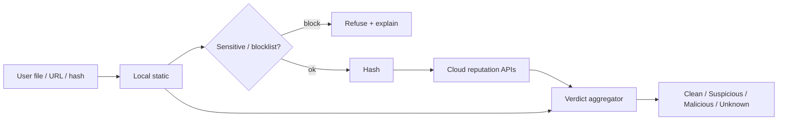

# Analyze Anything — VirusTotal-like design

## Goal

A Securely **Analyze** surface (dashboard first; website optional) where Kelly can paste a link, drop a file, or look up a hash and get a clear multi-signal verdict — **without scraping VirusTotal** and without uploading sensitive files by surprise.

## Inputs

| Input | UX | Notes |
|-------|-----|-------|
| File upload / drag-drop | Dashboard Analyze tab | Size cap (e.g. 32 MB free / higher paid) |
| URL / link paste | Same | Normalize, follow redirects carefully server-side |
| Hash (SHA-256 / SHA-1 / MD5) | Prefer first | Lookup before any upload |
| “Scan this download” deep-link | From Protect watcher | Pre-fills path/hash |

## Pipeline (recommended)

### Stage 1 — Local static (host or local worker)

- Hash (SHA-256 primary)  
- PE / ELF / Mach-O / archive metadata (open parsers)  
- YARA ruleset (bundled, updatable)  
- ClamAV if installed optionally; never require kernel AV  
- Reuse `sensitive.js` patterns on extracted strings / filenames (block credential dumps, wallet.dat, etc. unless explicit opt-in)

### Stage 2 — Cloud multi-signal (server only)

All API keys stay in `Securely-Website` / Edge env (same pattern as OpenRouter).

| Provider class | Role | Example |
|----------------|------|---------|
| Multi-engine | File/URL/hash reports | VirusTotal API v3 (licensed), MetaDefender Cloud |
| URL intel | Malicious URL lists | URLhaus / similar ToS-allowed feeds |
| Sandbox | Behavior (later) | Hybrid Analysis API |
| Own AI | Explain verdict in plain language | Existing OpenRouter path — **text summary of signals only**, not raw malware bytes |

**Never:** scrape VT web UI, share one public key in the desktop binary, or re-host malware samples publicly.

### Stage 3 — Verdict UX

| Verdict | Meaning |
|---------|---------|
| Clean | No strong malicious signals; show residual risk |
| Suspicious | Mixed engines / heuristics / phishing cues |
| Malicious | Strong consensus or known bad hash |
| Unknown | No cloud hit / offline / rate limited |

Show an **evidence timeline**: local hash → provider A → provider B → AI summary. One-click **Open in quarantine** / **Allow once** / **Copy report**.

## Privacy & abuse

| Control | Spec |
|---------|------|
| Hash-first | Always compute hash locally; query APIs by hash before upload |
| Opt-in upload | Explicit “Upload file for deep scan” |
| Sensitive blocklist | Refuse known secret-bearing paths; warn on PII-like filenames |
| Retention | Delete uploads after N days (default 7); paid longer optional |
| Rate limits | Per license key; anonymous IP throttle on website |
| Malware handling | Isolated storage; no sync to marketing CDN; admin access logged |

## API sketch (`Securely-Website`)

| Route | Method | Body | Response |
|-------|--------|------|----------|
| `/api/analyze-hash` | POST | `{ hash, type? }` | `{ verdict, engines[], evidence[] }` |
| `/api/analyze-url` | POST | `{ url }` | same |
| `/api/analyze-file` | POST | multipart or signed upload URL | analysis id → poll |
| `/api/analyze-status` | GET | `id` | progress + verdict |

Desktop calls these with the same license/session model as checkout. Do not put VT keys in `securely-app`.

## Open patterns to study (not clone)

- ClamAV + YARA local pipelines  
- PE parsing libraries  
- VT-style multi-engine **UI composition** (cards, detection ratio) — implement with our aggregator  
- Self-hosted fans-out patterns (conceptual) — prefer managed APIs for v1 reliability  

## Phase 1 MVP (see roadmap)

1. Dashboard **Analyze** tab: hash + URL + small file upload  
2. Local hash + one cloud provider (VT or MetaDefender) + URLhaus for URLs  
3. Sensitive gate before upload  
4. Verdict card + evidence list  
5. Deep-link from pill: “Analyze clipboard URL”
