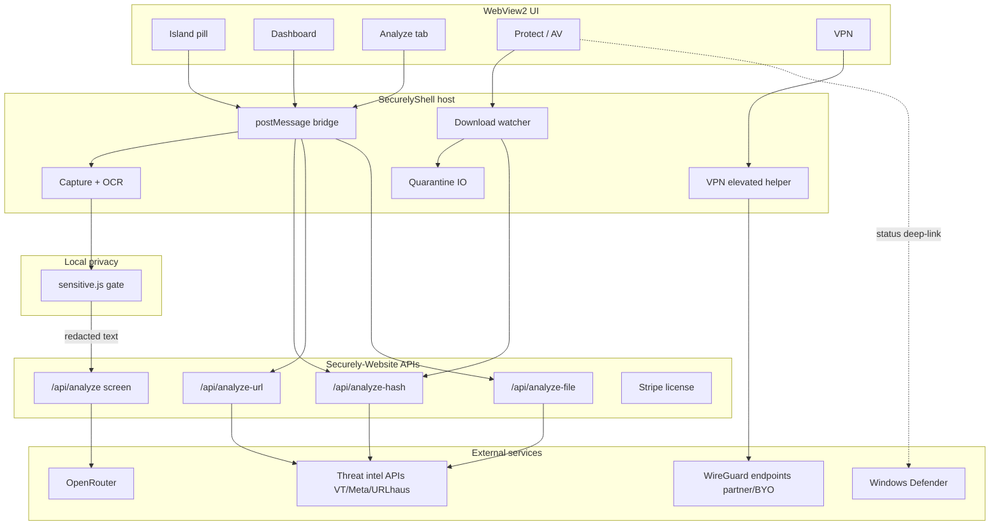

# System architecture

## One diagram

## Component roles

| Component | Responsibility |
|-----------|----------------|
| Pill | Always-visible status; Quick Scan; VPN/protect glance |
| Dashboard | Full controls, Analyze, policies, billing |
| Host | Privileged OS work: capture, files, quarantine, VPN |
| sensitive.js | No-network PII detection before any upload |
| Website APIs | Secrets, rate limits, Stripe, threat intel fan-out |
| Defender | Primary AV (coexist); Securely does not disable it in v1 |

## Data flow summary

1. **Screen path:** bitmap → OCR → sensitive gate → optional AI text → verdict → toast/hitbox/audit  
2. **Analyze path:** hash locally → API reputation → optional file upload → verdict card  
3. **Protect path:** filesystem event → hash/Analyze → quarantine  
4. **VPN path:** profile → helper → tunnel + WFP → status to UI  

## Trust boundaries

| Boundary | Rule |
|----------|------|
| UI ↔ Host | Typed postMessage only; no raw secrets in JS |
| Host ↔ Internet | Prefer site APIs; no VT/OpenRouter keys in binary |
| User ↔ Cloud | Consent for continuous OCR; opt-in file upload |
| VPN | Config private; server trust = operator of exit |

## Extensibility

New signals plug into a single **policy + audit** bus in host settings JSON so Analyze, Protect, VPN, and screen share one alert UX.
